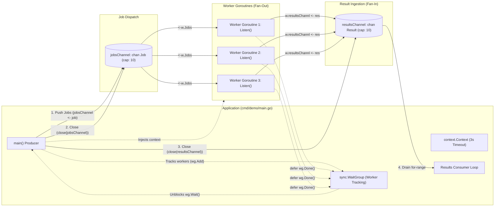
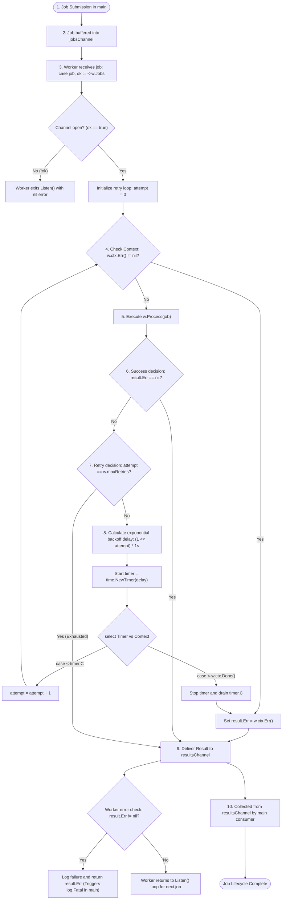

# Go Worker Pool Architecture Documentation

## A. Project Overview

The Go Worker Pool is a concurrent job execution engine built with Go. It solves the problem of controlled asynchronous processing of discrete workloads without overwhelming system resources.

In high-throughput backend services, spawning an unbounded number of goroutines to handle tasks (such as I/O operations, data transformations, or external API calls) can cause memory exhaustion, file descriptor starvation, CPU cache thrashing, and downstream service saturation. 

This project implements the **Worker Pool (Fan-Out / Fan-In)** pattern to:
- Bound concurrency to a fixed number of worker goroutines.
- Decouple job generation from job consumption using buffered channels.
- Provide resilience against transient failures through automated exponential backoff retries.
- Ensure controlled execution boundaries via Go context timeouts and channel-based graceful shutdown.

---

## B. System Architecture

The codebase comprises the following components and core responsibilities:

| Component | Source Reference | Primary Responsibility |
| :--- | :--- | :--- |
| **Application Entry Point** | `cmd/demo/main.go` | Orchestrates system initialization, configures contexts and channels, spawns worker goroutines, seeds jobs, coordinates graceful shutdown, and consumes results. |
| **Worker Pool Orchestration** | `cmd/demo/main.go` / `workerpool/pool.go` | Currently managed directly within the application entry point. A separate `Pool` abstraction (`workerpool/pool.go`) exists as a package placeholder and is not yet implemented. |
| **Worker** | `workerpool/worker.go` | Represents an individual concurrent processing unit (`Worker` struct). Consumes jobs, executes work units with retry logic, forwards results, and terminates upon channel exhaustion or cancellation. |
| **Job** | `workerpool/job.go` | Immutable payload model (`Job` struct) carrying an identifier (`ID`) and input payload data (`Input`). |
| **Result** | `workerpool/result.go` | Output model (`Result` struct) encapsulating the originating `JobID`, processed output (`Output`), and any terminal error (`Err`). |
| **Jobs Channel** | `chan Job` (in `cmd/demo/main.go`) | Buffered channel (`cap: 10`) facilitating thread-safe, decoupled transmission of jobs from producer to worker pool (Fan-Out). Owned and closed by `main`. |
| **Results Channel** | `chan Result` (in `cmd/demo/main.go`) | Buffered channel (`cap: 10`) aggregating outputs from all concurrent workers (Fan-In). Owned and closed by `main`. |
| **Synchronization Primitives** | `sync.WaitGroup` & `context.Context` | `sync.WaitGroup` tracks running worker goroutines for clean termination. `context.WithTimeout` enforces global deadlines and enables cancellation propagation across workers. |

### Component Structure Details

```
go-worker-pool/
├── cmd/
│   └── demo/
│       └── main.go           # Application entry point demonstrating worker pool execution
├── workerpool/
│   ├── job.go                # Job struct definition (ID, Input)
│   ├── pool.go               # Package placeholder (currently unpopulated)
│   ├── result.go             # Result struct definition (JobID, Output, Err)
│   ├── worker.go             # Worker struct, processing, retry backoff, and listen loop
│   └── worker_test.go        # Unit test placeholder
├── docs/
│   └── architecture.md       # System architecture and lifecycle documentation
├── go.mod                    # Go module definition (go 1.26.2)
└── makefile                  # Build, run, and race detection targets
```

---

## C. Architecture Diagram

The system employs a classic Fan-Out / Fan-In concurrency architecture:



---

## D. Job Lifecycle Diagram

The following state diagram depicts the path of a job from submission through dispatch, execution, exponential backoff retries, and result aggregation:



---

## E. Concurrency Model

The project adheres to Go's core concurrency philosophy: *"Do not communicate by sharing memory; instead, share memory by communicating."*

### 1. Goroutines
- **Main Goroutine**: Drives application startup, channel allocation, job pushing, worker synchronization, and results collection.
- **Worker Goroutines**: Independent execution threads spawned via `go func(id int) { ... }(i)`. The degree of concurrency is determined by the loop count (fixed at 3 in the current entry points). Each worker executes its `Listen()` loop concurrently and independently pulls jobs from the shared `jobsChannel`.

### 2. Channels
- **`jobsChannel` (`chan Job`)**:
  - Acts as a FIFO queue between the producer and the worker pool.
  - Sized with a buffer capacity of `10`, mitigating producer blocking up to 10 unconsumed jobs.
  - Multiplexed across multiple worker goroutines (Fan-Out). Channel synchronization semantics guarantee that each job is received by exactly one worker.
- **`resultsChannel` (`chan Result`)**:
  - Serves as the aggregation sink for worker outputs (Fan-In).
  - Sized with a buffer capacity of `10`.
  - Concurrently written to by all active workers and drained sequentially by `main`.

### 3. Synchronization Primitives
- **`sync.WaitGroup`**:
  - Coordinates worker lifecycle without polling or sleeping.
  - Initialized with `wg.Add(3)` corresponding to the worker count.
  - Each worker goroutine defers `wg.Done()`.
  - The main goroutine executes `wg.Wait()` after closing the `jobsChannel`, guaranteeing that all workers have completed execution before the `resultsChannel` is closed.
- **`sync.Mutex` / `sync.RWMutex`**:
  - **None present**. No shared state is mutated across goroutines. Job data is passed by value across channels, and each worker maintains its own local stack frame during processing.
- **`context.Context`**:
  - Rooted at `context.Background()` with a 3-second timeout (`context.WithTimeout`).
  - Thread-safely shared across all workers.
  - Acts as a cancellation signal observed via `<-w.ctx.Done()` within the worker `Listen()` loop, the `Process()` method, and the `ProcessWithRetry()` exponential backoff sleep.

---

## F. Retry Mechanism

The worker implements an in-memory exponential backoff retry mechanism within `ProcessWithRetry(job Job) Result`:

```go
for attempt := 0; attempt <= w.maxRetries; attempt++ {
    if w.ctx.Err() != nil {
        result.Err = w.ctx.Err()
        return result
    }
    result = w.Process(job)
    if result.Err == nil {
        return result
    }
    if attempt == w.maxRetries {
        return result
    }
    delay := time.Duration(1<<attempt) * time.Second
    timer := time.NewTimer(delay)
    select {
    case <-timer.C:
    case <-w.ctx.Done():
        if !timer.Stop() {
            select {
            case <-timer.C:
            default:
            }
        }
        result.Err = w.ctx.Err()
        return result
    }
}
```

### Key Characteristics:
1. **Attempt Calculation**:
   - The loop runs from `attempt := 0` to `attempt <= w.maxRetries`.
   - When configured with `maxRetries = 5`, the job is executed up to `6` total times (1 initial attempt + 5 retries).
2. **Backoff Growth**:
   - Exponential delay computed using bitwise shifting: `(1 << attempt)` seconds.
   - Attempt 0 failure: `1 << 0` = 1s delay before attempt 1.
   - Attempt 1 failure: `1 << 1` = 2s delay before attempt 2.
   - Attempt 2 failure: `1 << 2` = 4s delay before attempt 3.
   - Attempt 3 failure: `1 << 3` = 8s delay before attempt 4.
   - Attempt 4 failure: `1 << 4` = 16s delay before attempt 5.
3. **No Jitter**:
   - Backoff delays are deterministic without random jitter.
4. **Context Responsiveness**:
   - If context expires or is canceled during a backoff sleep, the worker immediately aborts via `case <-w.ctx.Done()`.
   - Properly stops and drains `timer.C` to prevent memory/goroutine leaks.
5. **Handling of Exhausted Retries**:
   - Once `attempt == w.maxRetries`, the loop terminates and delivers `result` containing the last error to `resultsChannel`.
   - In `Listen()`, receiving a non-nil `result.Err` causes the worker to log the failure and return `result.Err`, terminating the worker goroutine.

---

## G. Shutdown and Resource Management

Safe channel management and graceful termination are handled through strict channel ownership and Go runtime synchronization:

```
[Main Goroutine]
       │
       ├─► 1. Closes jobsChannel (close(jobsChannel))
       │
[Workers]
       ├─► 2. Detect closure (case job, ok := <-w.Jobs with !ok)
       ├─► 3. Exit Listen() loop and execute defer wg.Done()
       │
[Main Goroutine]
       ├─► 4. wg.Wait() unblocks after all workers finish
       ├─► 5. Closes resultsChannel (close(resultsChannel))
       └─► 6. Drains resultsChannel until empty
```

### 1. Channel Ownership
- In accordance with Go best practices, channels are closed exclusively by their sender/creator:
  - `jobsChannel`: Created and closed by `main`. Workers only receive (`<-chan Job`).
  - `resultsChannel`: Created and closed by `main`. Workers only send (`chan Result`).

### 2. Closure Detection & Worker Termination
- Workers monitor `w.Jobs` within a `select` statement using the two-value receive idiom:
  ```go
  case job, ok := <-w.Jobs:
      if !ok {
          return nil
      }
  ```
- When `jobsChannel` is closed and its buffer is empty, `ok` evaluates to `false`. The worker returns `nil`, triggering its deferred `wg.Done()`.

### 3. Graceful Draining
- **Normal Operation**: Closing `jobsChannel` does not discard buffered items. Workers continue processing remaining buffered jobs until the channel is fully drained.
- **Post-Worker Drain**: Because `main` waits on `wg.Wait()` before closing `resultsChannel`, no worker can attempt to send on a closed channel (which would cause a runtime panic). Once closed, `main` safely drains `resultsChannel` via `for resul := range resultsChannel`.

### 4. Cancellation Termination
- If the global timeout fires before all jobs finish:
  - Workers blocked on `select` in `Listen()` detect `case <-w.ctx.Done()` and exit.
  - Workers sleeping during retry backoff abort the timer and exit.
  - Each exiting worker triggers `defer wg.Done()`, unblocking `wg.Wait()`.

---

## H. Design Decisions and Limitations

An objective evaluation of the current implementation reveals the following design decisions and architectural trade-offs:

| Aspect | Current Implementation | Trade-off / Limitation |
| :--- | :--- | :--- |
| **Pool Abstraction** | Orchestration logic resides directly in `cmd/demo/main.go`. `workerpool/pool.go` is an unpopulated placeholder. | High coupling between application startup and worker pool lifecycle; cannot be easily imported as a reusable library. |
| **Worker Identification** | `var i int; for range 3 { go func(id int) { ... NewWorker(i, ...) }(i) }` | `i` is never incremented in the loop; all workers are initialized with `ID: 0`, impeding log tracing and worker attribution. |
| **Error Propagation & Fail-Fast** | If a job fails retries, `Listen()` returns `result.Err`, and `main` executes `log.Fatal(err)`. | A single persistent job failure terminates the entire operating system process (`os.Exit(1)`), causing all pending and in-flight jobs to be abandoned. |
| **Context Timeout vs. Retries** | Context timeout is fixed at 3s, while retry backoff reaches 1s + 2s + 4s... | Context timeout expires before multiple retry attempts can complete, causing premature cancellation during transient failures. |
| **In-Memory Storage** | Jobs and results reside purely in channel buffers in process memory. | If the process crashes or is terminated, all unprocessed and in-flight jobs are permanently lost. |
| **Dead-Letter Queue (DLQ)** | Failed jobs are dispatched to `resultsChannel` and logged; no DLQ exists. | No automated replay, inspection, or dead-letter queue routing for poison-pill jobs. |
| **Static Capacity & Worker Sizing** | Worker count (3) and channel buffer sizes (10) are compile-time constants. | Cannot adapt dynamically to varying workload volumes or system backpressure. |
| **Result Zero-Value on Cancel** | In `Process()`, if `w.ctx.Done()` fires, `Result` returns with zero values (`Output: 0, JobID: 0, Err: nil`). | Although mitigated by the pre-check in `ProcessWithRetry()`, `Process()` should explicitly populate `Result.Err = w.ctx.Err()`. |

---

## I. Future Improvements

The following architectural enhancements represent natural extensions for production-grade evolution:

### 1. Concrete Pool Coordinator Abstraction
- Populate `workerpool/pool.go` with a dedicated `Pool` struct providing clean lifecycle controls:
  - `NewPool(config Config) *Pool`
  - `pool.Submit(job Job) error`
  - `pool.Start(ctx context.Context)`
  - `pool.Stop() / pool.Wait()`

### 2. Dead-Letter Queue (DLQ)
- Route jobs that exceed `maxRetries` to a separate DLQ channel or persistent dead-letter storage rather than aborting the worker and application.

### 3. Configurable Backoff with Full Jitter
- Replace fixed binary exponential backoff with randomized jitter (e.g., Decorrelated Jitter or Full Jitter) to prevent thundering herd problems on upstream systems:
  $$\text{sleep} = \text{random}(0, \min(M, B \times 2^{\text{attempt}}))$$
- Introduce a maximum backoff ceiling (`maxBackoffDelay`).

### 4. Dynamic Worker Pool Scaling
- Monitor channel depth (`len(jobsChannel)`) vs capacity (`cap(jobsChannel)`).
- Dynamically scale worker goroutines between configured `minWorkers` and `maxWorkers` thresholds based on load.

### 5. Persistent Job Queues & Distributed Execution
- Replace in-memory Go channels with persistent message brokers (Redis Streams, RabbitMQ, Apache Kafka, or AWS SQS).
- Enables distributed execution across multiple stateless worker instances, horizontal scalability, and crash durability.

### 6. Observability and Metrics
- Export real-time telemetry using OpenTelemetry / Prometheus:
  - Gauges for active worker count and queue depth.
  - Counters for submitted, completed, retried, and failed jobs.
  - Histograms for end-to-end job duration and backoff latency.
- Structured logging with correlation IDs linking jobs across their lifecycle.
